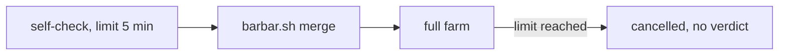
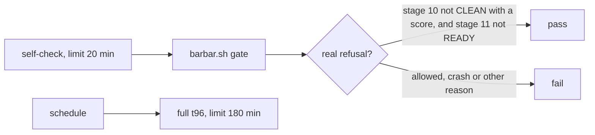

# Stage 05b — t97-self-check-gate — SPEC

## Problem and scope

The `self-check` job in `.github/workflows/pack-self-check.yml` must prove that the merge gate refuses on the pack repo. It has not given a verdict since 2026-10-23. The last successful run was at `d89438e`. CI cancels the job after about 5 minutes on `main` and on PRs (run 42314826062 at `a39735c`, and the run at `970744e`).

The job has these faults:

- The job has `timeout-minutes: 5` and runs `bash tests/barbar.sh merge`. That command runs the full farm first. The `eval` job also runs the farm, and it takes 23 minutes on CI.
- The job accepts any non-zero exit. A crash or a failing farm therefore counts as a refusal. If the job had time to finish, it could pass for the wrong reason.

The spec critic found one more fault, which the next hop would cause:

- `bash tests/goal.sh reset` carries `bash tests/ac/t96_install_repairs.sh` into `docs/cascade/regress.md`. The gate and the `regress` job run every line. The repo records about 98 minutes on a laptop for that script. The `self-check` job would again reach its limit, and the `regress` job (limit 60) is also at risk.

This slice changes the `self-check` job, the carried t96 line and one new pack-only workflow. It does not change the gate's rules, the farm's run time or any other job.

Branch protection is not in this slice. It could not be read (`gh` returns HTTP 401), and only the human can change it. See the question for C1.

## Approaches considered

| Approach | Decision | Reason |
|---|---|---|
| Raise the limit and keep `merge` | Rejected | CI runs the farm a second time, and any non-zero exit still passes. |
| Run `gate`, and read the refusal reason | **Chosen** | `eval` already runs the farm. The job then tests only the refusal. T14 in `tests/enforcement.sh` still runs `merge` on copied packs. |
| Delete the job | Rejected | No other job proves that the gate refuses on the pack itself. |
| Add the fixture cases to this job | Rejected | The farm already runs the gate on these fixtures. This job must test the pack repo. |
| Add an option that skips the regression suite in the gate | Rejected | A skip in the gate is a way past the gate. |
| Carry the full t96 line with `# gate-only` | Rejected | The gate runs these lines, so `self-check` still takes about 98 minutes or more. |
| Set a limit of about 180 minutes on `self-check` | Rejected | Each PR then holds a runner for hours, and the `regress` job still needs a change. |
| Carry `T96_FAST=1` and run the full t96 on a schedule | **Chosen** | The fast line took 43 s. The full script still runs, but not on each PR. |

## Before vs after

Before:

After:

## Benefits and trade-offs

| Item | Benefit | Cost or limit |
|---|---|---|
| `gate` in place of `merge` | The job can finish, and CI does not run the farm twice in this workflow. | CI no longer runs `merge` on the pack repo itself. T14 runs it on copied packs (`tests/enforcement.sh:134`, `:150`). |
| Read the refusal reason | A crash, a crash of `tests/audit.sh`, a failing farm or a wrong reason fails the job. | The job depends on the text of the refusal. AC2 runs the real gate, so a changed text goes red. |
| `timeout-minutes: 20` | The gate has time to finish. It took 440 s and 454 s on laptops, and the fast t96 line adds 43 s. | The CI time of `gate` is not measured. A later slow regression line can reach this limit. |
| `fetch-depth: 0` | `tests/regress.sh --gate` refuses a shallow clone, so the suite runs. | The checkout takes longer. |
| Fast t96 line | The gate and the `regress` job stay inside their limits. | **PRs no longer run t96 AC10 and AC11.** A fault in the install-mode CI replay is found on the next scheduled run, not on the PR. |
| Scheduled full t96 | AC10 and AC11 still run each night and on request. | It is a report and it blocks no merge. Its time on GitHub is not measured, and it can reach 180 minutes. |
| Allow-list of job keys | `continue-on-error`, `if`, `env`, `shell` and a step limit cannot change the verdict. | Each later new key in this job needs an oracle change, which is the human's to accept. |

## Decision contract

### The job

1. The job runs `bash tests/barbar.sh gate`, one time. It does not run `merge`.
2. The job does not set or name `BARBAR_ROOT`, so the gate reads the pack repo.
3. The job prints the gate's output to the log.
4. The job passes only when both conditions are true:
   - The gate's exit code is not 0.
   - The output matches `stage 10 CLEAN by tests/audit.sh \(=0, AUDIT [0-9]+/[0-9]+\)` and `stage 11 READY \(=0\)`.
5. In all other cases, the job fails with a message that says why.
6. The job has `timeout-minutes: 20` at job level. The oracle accepts 15 to 60.
7. The job's checkout has `fetch-depth: 0`.
8. The job holds only the keys `runs-on`, `timeout-minutes`, `steps`, `uses`, `with`, `fetch-depth`, `name` and `run`. Above `jobs:`, the workflow holds only `name`, `on`, `pull_request`, `push`, `branches: [main]`, `permissions` and `contents`.

A failing regression line does not fail this job, because the gate still refuses for the two stated reasons. The `regress` job reports that failure.

### The carried t96 line

9. On EXECUTE, run `bash tests/goal.sh reset`. Change the new line to `REGRESS: T96_FAST=1 bash tests/ac/t96_install_repairs.sh` before the first commit of `regress.md`. The line is not yet in HEAD, so this does not change a committed line.
10. Do not run `bash tests/goal.sh carry-out` on this hop. In a scratch clone, it added the full line back. AC6 goes red if the full line returns.
11. The loop can print a note that a t96 goal line is in neither the goal nor the suite. This note is expected, and it is not a refusal.

### The scheduled workflow

12. Add `.github/workflows/pack-install-repair.yml`. It runs on `schedule` and `workflow_dispatch`. Its one job has `timeout-minutes: 180`, a checkout with `fetch-depth: 0`, and the step `run: bash tests/ac/t96_install_repairs.sh`.
13. `install.sh` does not ship this file.

### Release

These workflows are pack-only. `install.sh` copies only `control-line.yml` and, on request, `nightly.yml`. A product gets no change, so this slice does not change the version. `CHANGELOG.md` is not changed.

### Files that may change on EXECUTE

`.github/workflows/pack-self-check.yml`, `.github/workflows/pack-install-repair.yml` (new), `docs/cascade/goal.md`, `docs/cascade/regress.md`.

### Files that must not change on EXECUTE

`tests/ac/t97_self_check_gate.sh`, `docs/cascade/05b-t97-self-check-gate.oracle`, `tests/ac/t96_install_repairs.sh`, `tests/barbar.sh`, `.github/workflows/control-line.yml`, the `gradle-runner` job.

## Acceptance criteria and the frozen oracle

The oracle is `tests/ac/t97_self_check_gate.sh`. It extracts the job's run step and runs it with `bash -e`, which GitHub uses for a step with no `shell` key. AC5 refuses a `shell` key.

| AC | Requirement | How the oracle proves it |
|---|---|---|
| AC0 | The job has a run step. | It extracts the step. |
| AC1 | The job calls `gate` one time on the pack, passes on the real refusal and logs the output. | A stub `tests/barbar.sh` records its arguments and `BARBAR_ROOT`, and prints the refusal. |
| AC2 | The job reads the text that the gate prints. | The real gate runs through `BARBAR_ROOT`. `no-prr-product`: the job passes. `ready-product`: the job fails. |
| AC3 | Only the real refusal passes. | The stub gives eight other results, which include a refusal with no audit score. The job must fail on each. |
| AC4 | The job has the time and history that the gate needs. | It reads the job-level `timeout-minutes` and `fetch-depth`. |
| AC5 | YAML cannot switch off the job, and the rest stays. | It checks both allow-lists, the triggers, that `gradle-runner` exists and the `merge` path in `tests/barbar.sh`. |
| AC6 | The suite holds the fast t96 line and not the full line. | It reads `regress.md`. |
| AC7 | The full t96 still runs, and products do not get the workflow. | It reads `pack-install-repair.yml` and `install.sh`. |

The oracle never runs the gate on `$ROOT`. The gate runs `tests/regress.sh`, and `regress.md` can hold this oracle after carry-out, so that call would not end. The oracle also does not parse YAML fully. It reads the known shape of these files, so a key in an unusual form may escape it.

## Laws and boundaries

- `NO LAW IN FORCE`: this repo declares no D#.
- This slice makes the `self-check` job stricter. It removes the job's run of the farm, which `eval` still runs on the same events.
- **This slice reduces what each PR runs for t96.** AC1 to AC9 stay on PRs, and AC10 and AC11 move to a schedule. The human accepts this at the edge.

## Evidence limits

- The oracle runs on the extracted step, on macOS. Only the first CI run proves the job on GitHub, and only that run measures its time. The scheduled full t96 has the same limit.
- `tests/ac/t97_self_check_gate.sh` does not run the gate on the pack repo. The hop report must include one run of the extracted step on the committed pack repo, with its time and the `REGRESS k/n` it printed. The run is not valid when `regress.md` differs from HEAD, because the suite then refuses and runs no line.
- The 23-minute figure is the whole `eval` job at `a39735c`, not the farm alone.
- The brief says that the regression suite is most of the gate's work. That was not measured. The 440 s and 454 s figures are the whole gate. The critic's run also printed `REGRESS 17/17`.
- The critic reviewed the spec at `35e6283`. The answers below changed the spec and the oracle, and no second critic has reviewed the changes.
- The job proves that the gate refuses today. It does not prove the gate's other rules. The farm covers those on fixtures.
- Whether this job is a required check is not known. See C1.
