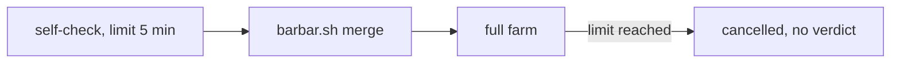
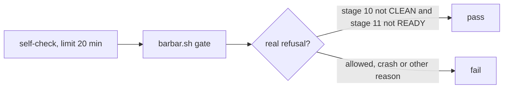

# Stage 05b — t97-self-check-gate — SPEC

## Problem and scope

The `self-check` job in `.github/workflows/pack-self-check.yml` must prove that the merge gate refuses on the pack repo. It has not given a verdict since 2026-10-23. The last successful run was at `d89438e`. CI cancels the job after about 5 minutes on `main` and on PRs (run 42314826062 at `a39735c`, and the run at `970744e`).

The job has these faults:

- The job has `timeout-minutes: 5` and runs `bash tests/barbar.sh merge`. That command runs the full farm first. The `eval` job also runs the farm, and it takes 23 minutes on CI.
- The job accepts any non-zero exit. A crash or a failing farm therefore counts as a refusal. If the job had time to finish, it could pass for the wrong reason.

This slice changes only that job. It does not change the gate's rules, the farm's run time or any other job.

## Approaches considered

| Approach | Decision | Reason |
|---|---|---|
| Raise the limit and keep `merge` | Rejected | CI runs the farm a second time, and any non-zero exit still passes. |
| Run `gate`, and read the refusal reason | **Chosen** | `eval` already runs the farm. The job then tests only the refusal. T27 and T29 in `tests/enforcement.sh` still run `merge`. |
| Delete the job | Rejected | No other job proves that the gate refuses on the pack itself. |
| Add the fixture cases to this job | Rejected | The farm already runs the gate on these fixtures. This job must test the pack repo. |

## Before vs after

Before:

After:

## Benefits and trade-offs

| Item | Benefit | Cost or limit |
|---|---|---|
| `gate` in place of `merge` | The job can finish, and CI does not run the farm twice in this workflow. | CI no longer runs `merge` on the pack repo itself. T27 and T29 run it on copied packs, and AC5 reads that it still runs the farm first. |
| Read the refusal reason | A crash, a failing farm or a wrong reason fails the job. | The job depends on the text of the refusal. AC2 runs the real gate, so a changed text goes red. |
| `timeout-minutes: 20` | The gate has time to finish. It took 440 s on this machine. | The CI time of `gate` is not measured. The first CI run gives that number. |
| `fetch-depth: 0` | `tests/regress.sh --gate` and `tests/retirements.sh` see the history, as in the `regress` job. | The checkout takes longer. |

## Decision contract

### The job

1. The job runs `bash tests/barbar.sh gate`, one time. It does not run `merge`.
2. The job prints the gate's output to the log.
3. The job passes only when both conditions are true:
   - The gate's exit code is not 0.
   - The output holds `stage 10 CLEAN by tests/audit.sh (=0,` and `stage 11 READY (=0)`.
4. In all other cases, the job fails with a message that says why.
5. The job has `timeout-minutes: 20`. The oracle accepts 15 to 60.
6. The job's checkout has `fetch-depth: 0`.

A failing regression line does not fail this job, because the gate still refuses for the two stated reasons. The `regress` job reports that failure.

### Release

The workflow is pack-only, because `install.sh` does not copy it. A product gets no change, so this slice does not change the version. `CHANGELOG.md` is not changed.

### Files that may change on EXECUTE

`.github/workflows/pack-self-check.yml`, `docs/cascade/goal.md`, `docs/cascade/regress.md`.

### Files that must not change on EXECUTE

`tests/ac/t97_self_check_gate.sh`, `docs/cascade/05b-t97-self-check-gate.oracle`, `tests/barbar.sh`, `.github/workflows/control-line.yml`, the `gradle-runner` job.

## Acceptance criteria and the frozen oracle

The oracle is `tests/ac/t97_self_check_gate.sh`. It extracts the job's run step from the workflow and runs it with `bash -e`, as GitHub does.

| AC | Requirement | How the oracle proves it |
|---|---|---|
| AC0 | The job has a run step. | It extracts the step. |
| AC1 | The job calls `gate` one time, passes on the real refusal and logs the output. | A stub `tests/barbar.sh` records its arguments and prints the refusal. |
| AC2 | The job reads the text that the gate prints. | The real gate runs through `BARBAR_ROOT`. `no-prr-product`: the job passes. `ready-product`: the job fails. |
| AC3 | Only the real refusal passes. | The stub gives seven other results, and the job must fail on each. |
| AC4 | The job has the time and history that the gate needs. | It reads `timeout-minutes` and `fetch-depth`. |
| AC5 | The rest stays. | It reads the triggers, the `gradle-runner` job and the `merge` path in `tests/barbar.sh`. |

The oracle never runs the gate on `$ROOT`. The gate runs `tests/regress.sh`, and `regress.md` can hold this oracle after carry-out, so that call would not end.

## Laws and boundaries

- `NO LAW IN FORCE`: this repo declares no D#.
- This slice makes the job stricter. It removes the job's run of the farm, which `eval` still runs on the same events.

## Evidence limits

- The oracle runs on the extracted step, on macOS. Only the first CI run proves the job on GitHub, and only that run measures its time.
- `tests/ac/t97_self_check_gate.sh` does not run the gate on the pack repo. The hop report must include one run of the extracted step on the pack repo.
- The 23-minute figure is the whole `eval` job at `a39735c`, not the farm alone.
- The brief says that the regression suite is most of the gate's work. That was not measured. The 440 s figure is the whole gate.
- The job proves that the gate refuses today. It does not prove the gate's other rules. The farm covers those on fixtures.
