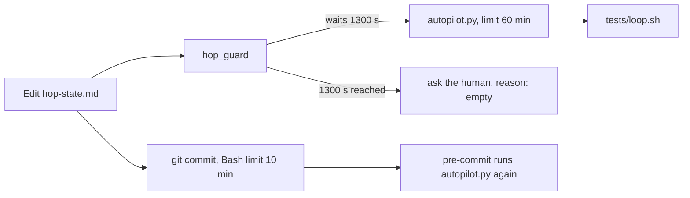
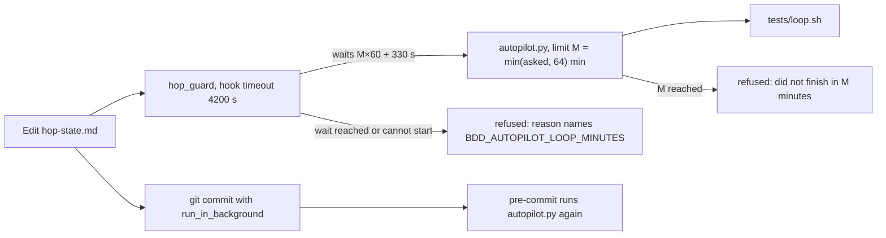

# Stage 05b — t99-gate-timeout — SPEC

## Problem and scope

On an EXECUTE→next autopilot edge, the gate runs `tests/loop.sh` before it allows the edge. Three time limits control
that run, and they do not agree:

| Limit | Where | Value |
|---|---|---|
| The gate's own limit | `tests/lib/autopilot.py:29` (`LOOP_MINUTES`), changed by `BDD_AUTOPILOT_LOOP_MINUTES` | 60 minutes |
| hop_guard's wait for `autopilot.py` | `.claude/hooks/hop_guard.py:129` (`timeout=1300`) | 1300 s, about 21.7 minutes |
| The host's limit for the hook | `hooks/hooks.json` and `.claude/settings.json` set no `timeout` for `hop_guard` | the host default |

When the 1300 s wait ends, `autopilot_ok` catches the exception and returns `(False, "")`
(`.claude/hooks/hop_guard.py:134-135`). `hop_guard` then asks the human to sign the edge, and the dialog gives no
autopilot reason (`.claude/hooks/hop_guard.py:412-417`). Thus each loop that takes more than about 22 minutes sends
the edge back to a human with no reason given. A product user reported loops of 17 to 66 minutes on 2026-11-09.

There is a fourth limit. After the edit, the agent commits the edge, and `.githooks/pre-commit:227` runs
`autopilot.py` again, so the loop runs a second time. The agent runs `git commit` through its Bash tool, which stops a
foreground command after 10 minutes at most. A long loop therefore also stops the commit.

This slice makes one limit control the gate in `hop_guard`, gives every refusal a reason, ships a matching hook
`timeout`, brings that `timeout` to existing installs, and tells the agent to commit an EXECUTE→next edge in the
background. It does not change the loop's run time, the second loop run in `pre-commit`, or what the gate checks.

## Approaches considered

| Approach | Decision | Reason |
|---|---|---|
| Raise `1300` to a bigger constant | Rejected | The limits still do not agree when `BDD_AUTOPILOT_LOOP_MINUTES` changes, and a timeout still gives an empty reason. |
| `hop_guard` calculates its wait from the gate's limit, and hands a limit to `autopilot.py` that fits under the hook's `timeout` | **Chosen** | `autopilot.py` is always the first to stop, and its message names the limit. |
| `hop_guard` allows the edit without the loop, and only `pre-commit` runs the loop | Rejected | The working tree then says GENERATE for the next slice before the loop passed. Layer 2 becomes weaker (I18). |
| The gate accepts an existing `.cascade/loop-receipt` for the same tree | Out of scope | A local file can be forged, and the gate takes the place of the human. This is a human decision. |
| Remove the second loop run in `pre-commit` | Out of scope | Layer 1 must decide without Layer 2. t101 (goal verdict cache) makes the second run cheap. |

## Before vs after

Before:

After:

## Benefits and trade-offs

| Item | Benefit | Cost or limit |
|---|---|---|
| Wait calculated from the gate's limit | A loop of up to 60 minutes (the default) can pass the edge in `hop_guard`. | One edge can hold the session for up to 70 minutes. |
| Limit lowered to fit the hook | `autopilot.py` stops first, so its message reaches the human. | A user who asks for more than 64 minutes gets 64 in `hop_guard`. `pre-commit` still uses the full value. |
| A reason for each refusal | The human sees why autopilot did not take the edge. | None. |
| Hook `timeout: 4200` | The host does not stop `hop_guard` before the gate. | A gate that hangs holds the session for 70 minutes. |
| `install.sh` sets the `timeout` on an existing entry | Existing copy-mode installs get it on the next install or refresh. | An install that is not refreshed keeps the host default. |
| Commit in the background | The Bash limit does not stop the commit while `pre-commit` runs the loop. | The agent must wait for the background task. |

## Decision contract

### `hop_guard.py`

1. `HOOK_SECONDS = 4200` is the `timeout` that both shipped configs give `hop_guard`. `SWITCH_SECONDS = 300` is the
   switch review's limit (`tests/lib/autopilot.py`, the `switch.sh` call). `MARGIN = 30`.
2. `autopilot_ok(root, before, after)` keeps its signature and return type.
3. It reads the asked limit with `autopilot.loop_minutes()`, so a missing or wrong value means 60, as in `autopilot.py`.
4. It calculates `M = min(asked, (HOOK_SECONDS - SWITCH_SECONDS - 2 * MARGIN) // 60)`, which is 64, and `M ≥ 1`.
5. It runs `autopilot.py` with `BDD_AUTOPILOT_LOOP_MINUTES=M` in the child's environment, and with
   `timeout = M * 60 + SWITCH_SECONDS + MARGIN`. This is at most `HOOK_SECONDS - MARGIN`.
6. On `subprocess.TimeoutExpired`, it returns `(False, "the autopilot gate did not finish in <timeout> s … BDD_AUTOPILOT_LOOP_MINUTES …")`.
   If `M` is less than the asked value, the reason also says that the hook's `timeout` lowered it.
7. On any other exception, it returns `(False, "could not run tests/lib/autopilot.py (<exc>) … BDD_AUTOPILOT_LOOP_MINUTES …")`.
8. The rest of `hop_guard.py` does not change. A refused edge still goes to `sign_or_deny`, which asks the human or
   denies.

### Hook configs

9. `hooks/hooks.json` and `.claude/settings.json` give the `hop_guard` PreToolUse entry `"timeout": 4200`.
   No other entry changes.

### `install.sh`

10. When the settings merge finds an existing entry with the same `hop_guard` command, it sets our `timeout` on that
    entry if the entry has no `timeout` or a smaller one. It keeps a larger one. It adds no second entry. It does not
    change other entries or the user's own hooks.

### `/barbar` command

11. In `.claude/commands/barbar.md` and `commands/barbar.md`, step 4 says: commit the EXECUTE→next edge with
    `run_in_background`, because `pre-commit` runs `tests/loop.sh` again and the Bash tool stops a foreground command
    after at most 10 minutes. Then wait for the task's notification.

### Release

12. Products get changed hooks and configs, so this is 3.5.2. Set it in `VERSION`, `.claude-plugin/plugin.json`,
    `.claude-plugin/marketplace.json` and `README.md`, and add a dated `## 3.5.2` section to `CHANGELOG.md`.

### Files that may change on EXECUTE

`.claude/hooks/hop_guard.py`, `hooks/hooks.json`, `.claude/settings.json`, `install.sh`, `.claude/commands/barbar.md`,
`commands/barbar.md`, `VERSION`, `.claude-plugin/plugin.json`, `.claude-plugin/marketplace.json`, `README.md`,
`CHANGELOG.md`, `tests/enforcement.sh` (the T-range text and a T99 entry, if the pattern of earlier slices needs it),
`docs/cascade/goal.md`, `docs/cascade/regress.md`.

### Files that must not change on EXECUTE

`tests/ac/t99_gate_timeout.sh`, `docs/cascade/05b-t99-gate-timeout.oracle`, `tests/lib/autopilot.py`,
`.githooks/pre-commit`, `tests/loop.sh`.

## Acceptance criteria and the frozen oracle

The oracle is `tests/ac/t99_gate_timeout.sh`.

| AC | Requirement | How the oracle proves it |
|---|---|---|
| AC1 | `hop_guard` waits for the whole gate, under the hook's `timeout` (items 3–5). | It replaces `subprocess.run` in `hop_guard`, and reads the timeout and the child's `BDD_AUTOPILOT_LOOP_MINUTES` for asked values unset, 1, 30, 60 and 500. It compares them with the `timeout` in `hooks/hooks.json`. |
| AC2 | A refusal from `hop_guard`'s own wait has a reason (items 6–7). | It makes `subprocess.run` raise `TimeoutExpired`, then `OSError`, and reads the reason. |
| AC3 | `autopilot.py`'s own message reaches the dialog. | The real `hop_guard` on a scratch repo, a 90 s validator and `BDD_AUTOPILOT_LOOP_MINUTES=1`. It also passes before the fix: it guards against a fix that breaks the path. |
| AC4 | Both configs give `hop_guard` the same `timeout`, from 3960 s to 7200 s (item 9). | It reads both JSON files. |
| AC5 | `install.sh` brings the `timeout` to an existing entry (item 10). | `install.sh --no-plugin` on scratch repos whose `settings.json` has the entry with no `timeout`, and with `timeout: 7000`, plus a user hook. |
| AC6 | The `/barbar` command says to commit the edge in the background (item 11). | It reads step 4 in both copies. |

`# fails-before-fix: yes`: AC1, AC2, AC4, AC5 and AC6 fail on the unfixed code. The oracle takes about 65 s, most of
it for AC3.

## Laws and boundaries

- `NO LAW IN FORCE`: this repo declares no D#.
- The gate does not check less. `autopilot.py` and `pre-commit` do not change.
- A limit above 64 minutes is lowered in `hop_guard` only. `pre-commit` and a human's own loop use the full value.

## Evidence limits

- The host's default hook timeout and what the host does when it stops a PreToolUse hook were not checked in this hop.
  The shipped `timeout` makes the host default not apply to new installs and to refreshed ones.
- AC1 and AC2 replace `subprocess.run`. They prove what `hop_guard` asks for, not a real 22-minute loop.
- On a GENERATE→EXECUTE edge, `autopilot.py` runs `critique.sh`, `diverge.sh` and `oracle.sh` with 300 s each. With a
  small `BDD_AUTOPILOT_LOOP_MINUTES`, `hop_guard`'s wait can be shorter than those three. The edge is then refused with
  item 6's reason. This was not tested.
- The second loop run in `pre-commit` stays. Each EXECUTE→next edge runs the loop two times.
