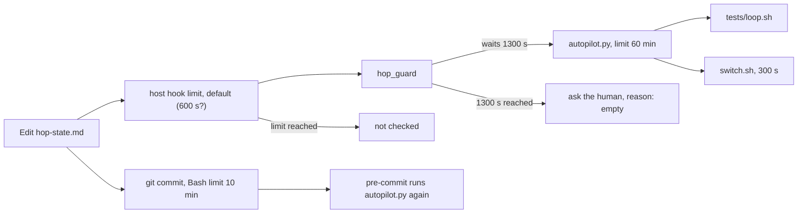
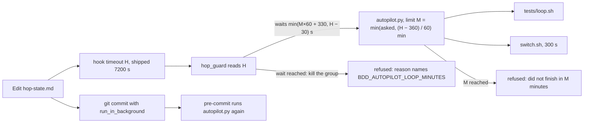

# Stage 05b — t99-gate-timeout — SPEC

## Problem and scope

On an EXECUTE→next autopilot edge, the gate runs `tests/loop.sh` before it allows the edge. Three time limits control
that run, and they do not agree:

| Limit | Where | Value |
|---|---|---|
| The gate's own limit | `tests/lib/autopilot.py:29` (`LOOP_MINUTES`), changed by `BDD_AUTOPILOT_LOOP_MINUTES` | 60 minutes |
| hop_guard's wait for `autopilot.py` | `.claude/hooks/hop_guard.py:129` (`timeout=1300`) | 1300 s, about 21.7 minutes |
| The host's limit for the hook | `hooks/hooks.json` and `.claude/settings.json` set no `timeout` for `hop_guard` | the host default (Claude Code: 600 s, not checked in this hop) |

When the 1300 s wait ends, `autopilot_ok` catches the exception and returns `(False, "")`
(`.claude/hooks/hop_guard.py:134-135`). `hop_guard` then asks the human to sign the edge, and the dialog gives no
autopilot reason (`.claude/hooks/hop_guard.py:412-417`). Thus each loop that takes more than about 22 minutes sends
the edge back to a human with no reason given. A product user reported loops of 17 to 66 minutes on 2026-11-09.

The 1300 s wait does not explain a 17-minute loop that was sent back (critique C1). The host's own limit, which is
shorter, probably stopped `hop_guard` first. What the host then does with the edit was not checked. If the host lets
the edit through, `.githooks/pre-commit` still runs the gate before the commit (Layer 1), so a red loop cannot be
committed. This slice removes the host default from the path: it ships a hook `timeout`, and `hop_guard` reads that
value and stays under it.

There is a fourth limit. After the edit, the agent commits the edge, and `.githooks/pre-commit:227` runs
`autopilot.py` again, so the loop runs a second time. The agent runs `git commit` through its Bash tool, which stops a
foreground command after 10 minutes at most. A long loop therefore also stops the commit.

This slice makes one limit control the gate in `hop_guard`, gives every refusal a reason, ships a hook `timeout`
that `hop_guard` reads, brings that `timeout` to existing installs, and tells the agent to commit both autopilot edges
in the background. It does not change the loop's run time, the second loop run in `pre-commit`, or what the gate checks.

## Approaches considered

| Approach | Decision | Reason |
|---|---|---|
| Raise `1300` to a bigger constant | Rejected | The limits still do not agree when `BDD_AUTOPILOT_LOOP_MINUTES` changes, and a timeout still gives an empty reason. |
| The hook `timeout` comes from `loop_minutes()` plus a margin (the brief's words) | Rejected | The hook `timeout` is a number in a static JSON file. It cannot follow an environment variable. |
| `hop_guard` reads its own hook `timeout` H from the config that runs it, and hands `autopilot.py` a limit that fits under H | **Chosen** | `autopilot.py` is always the first to stop, and its message names the limit. A user who sets a larger H gets a larger limit (critique C2, C10). |
| `hop_guard` allows the edit without the loop, and only `pre-commit` runs the loop | Rejected | The working tree then says GENERATE for the next slice before the loop passed. Layer 2 becomes weaker (I18). |
| The gate accepts an existing `.cascade/loop-receipt` for the same tree | Out of scope | A local file can be forged, and the gate takes the place of the human. This is a human decision. |
| Remove the second loop run in `pre-commit` | Out of scope | Layer 1 must decide without Layer 2. t101 (goal verdict cache) makes the second run cheap. |

## Before vs after

Before:

After:

## Benefits and trade-offs

| Item | Benefit | Cost or limit |
|---|---|---|
| Wait calculated from the gate's limit and the hook's H | A loop of up to 114 minutes can pass the edge in `hop_guard` with the shipped H. The reported 66-minute loop fits with `BDD_AUTOPILOT_LOOP_MINUTES=90`. | One edge can hold the session for up to 2 hours. |
| Limit lowered to fit H | `autopilot.py` stops first, so its message reaches the human. | A user who asks for more than `(H − 360) / 60` minutes gets that value in `hop_guard`. `pre-commit` still uses the full value. |
| An install with no hook `timeout` | `hop_guard` assumes 600 s, so it stays under the host default. | Such an install gets a 4-minute limit in `hop_guard` until `install.sh` runs again. The reason says so. |
| A reason for each refusal | The human sees why autopilot did not take the edge. | None. |
| Hook `timeout: 7200` | The host does not stop `hop_guard` before the gate. | A gate that hangs holds the session for 2 hours. |
| `install.sh` sets the `timeout` on an existing entry | Existing copy-mode installs get it on the next install or refresh. | An install that is not refreshed keeps the host default. |
| Commit in the background | The Bash limit does not stop the commit while `pre-commit` runs the loop. | The agent must wait for the background task. |

## Decision contract

### `hop_guard.py`

1. `SWITCH_SECONDS = 300` is the switch review's limit (the `switch.sh` call in `tests/lib/autopilot.py`). `MARGIN = 30`.
   `HOST_DEFAULT = 600` is the value `hop_guard` assumes when no hook `timeout` is found.
2. `autopilot_ok(root, before, after)` keeps its signature and return type.
3. It reads its own hook `timeout` H: in plugin mode (`BDD_PLUGIN_ROOT` set), from `$BDD_PLUGIN_ROOT/hooks/hooks.json`;
   else from `<root>/.claude/settings.json`. The entry is the PreToolUse hook whose command names `hop_guard`. If the
   file or the key is missing or not an integer, H = `HOST_DEFAULT`.
4. It loads `loop_minutes` from `<root>/tests/lib/autopilot.py`, the same file it runs (critique C5). If that fails, it
   returns item 7's reason. It does not use a value of its own.
5. It calculates `M = max(1, min(asked, (H − SWITCH_SECONDS − 2 × MARGIN) // 60))`. With H = 7200, the cap is 114.
6. It starts `<root>/tests/lib/autopilot.py` with `subprocess.Popen(..., start_new_session=True)`, with
   `BDD_AUTOPILOT_LOOP_MINUTES=M` in the child's environment, and waits `min(M × 60 + SWITCH_SECONDS + MARGIN, H − MARGIN)` s.
7. When the wait ends, it kills the child's process group (`os.killpg`) and returns `(False, "the autopilot gate did not
   finish in <wait> s … BDD_AUTOPILOT_LOOP_MINUTES …")`. If `M` is less than the asked value, the reason also says that
   the hook `timeout` lowered it, and where H came from. On any other exception it returns
   `(False, "could not run tests/lib/autopilot.py (<exc>) … BDD_AUTOPILOT_LOOP_MINUTES …")`.
8. `autopilot.py` kills the loop's own process group when `M` is reached (`tests/lib/autopilot.py:53-66`), before
   `hop_guard`'s wait ends. Item 7 kills what runs in `autopilot.py`'s group after the loop: `switch.sh` and the
   GENERATE→EXECUTE gates (critique C4).
9. The rest of `hop_guard.py` does not change. A refused edge still goes to `sign_or_deny`, which asks the human or
   denies.

### Hook configs

10. `hooks/hooks.json` and `.claude/settings.json` give the `hop_guard` PreToolUse entry `"timeout": 7200`.
   No other entry changes.

### `install.sh`

11. When the settings merge finds an existing entry with the same `hop_guard` command, it sets our `timeout` on that
    entry if the entry has no `timeout` or a smaller one. It keeps a larger one. It adds no second entry. It does not
    change other entries or the user's own hooks.

### `/barbar` command

12. In `.claude/commands/barbar.md` and `commands/barbar.md`, steps 2 and 4 say: commit the edge with
    `run_in_background`, because `pre-commit` runs the gate again (the loop on step 4; `critique.sh`, `diverge.sh` and
    `oracle.sh` on step 2) and the Bash tool stops a foreground command after at most 10 minutes. Then wait for the
    task's notification (critique C9).

### Release

13. Products get changed hooks and configs, so this is 3.5.2. Set it in `VERSION`, `.claude-plugin/plugin.json`,
    `.claude-plugin/marketplace.json` and `README.md`, and add a dated `## 3.5.2` section to `CHANGELOG.md`.

### Files that may change on EXECUTE

`.claude/hooks/hop_guard.py`, `hooks/hooks.json`, `.claude/settings.json`, `install.sh`, `.claude/commands/barbar.md`,
`commands/barbar.md`, `VERSION`, `.claude-plugin/plugin.json`, `.claude-plugin/marketplace.json`, `README.md`,
`CHANGELOG.md`, `tests/enforcement.sh` (the T-range text and a T99 entry, if the pattern of earlier slices needs it),
`docs/cascade/goal.md`, `docs/cascade/regress.md`.

### Files that must not change on EXECUTE

`tests/ac/t99_gate_timeout.sh`, `docs/cascade/05b-t99-gate-timeout.oracle`, `tests/lib/autopilot.py`,
`.githooks/pre-commit`, `tests/loop.sh`.

## Acceptance criteria and the frozen oracle

The oracle is `tests/ac/t99_gate_timeout.sh`.

| AC | Requirement | How the oracle proves it |
|---|---|---|
| AC1 | `hop_guard` reads H, hands `autopilot.py` M and waits for it (items 3–6). | On scratch roots with H = 7200, 1000, none (600) and a plugin `hooks.json` with 3000, and asked values unset, 1, 30, 60, 66, 500 and `abc`, it replaces `subprocess` in `hop_guard` and checks the script path, the exact M, and the wait. |
| AC2 | A refusal from `hop_guard`'s own wait has a reason, and the gate's group is killed (item 7). | A fake `TimeoutExpired` and a fake `OSError`; then a real stub `autopilot.py` that ignores its limit and starts a child, with H = 120: `hop_guard` gives up after about 90 s, and the child is gone. |
| AC3 | `autopilot.py`'s own message reaches the dialog. | The real `hop_guard` on a scratch repo, a 90 s validator and `BDD_AUTOPILOT_LOOP_MINUTES=1`. It also passes before the fix: it guards against a fix that breaks the path. |
| AC4 | Both configs give `hop_guard` the same `timeout`, from 3960 s to 7200 s (item 10). | It reads both JSON files. |
| AC5 | `install.sh` brings the `timeout` to an existing entry (item 11). | `install.sh --no-plugin` on scratch repos whose `settings.json` has the entry with no `timeout`, with `timeout: 60` and with `timeout: 9000`, plus a user hook. |
| AC6 | The `/barbar` command says to commit both autopilot edges in the background (item 12). | It reads steps 2 and 4 in both copies. |

`# fails-before-fix: yes`: AC1, AC2, AC4, AC5 and AC6 fail on the unfixed code. On the fixed code the oracle takes
about 3 minutes (AC2's real timeout and AC3). On the unfixed code AC2's stub runs for 600 s.

The brief asks for a test in which a loop longer than 1300 s passes (critique C3). The oracle does not run a loop that
long. AC1 checks what `hop_guard` asks for against H, and AC2 runs a real wait with a small H. The 1300 s case is a
scaled-down copy of the same rule.

## Laws and boundaries

- `NO LAW IN FORCE`: this repo declares no D#.
- The gate does not check less. `autopilot.py` and `pre-commit` do not change.
- A limit above `(H − 360) / 60` minutes is lowered in `hop_guard` only. `pre-commit` and a human's own loop use the full value.

## Evidence limits

- The host's default hook timeout (600 s on Claude Code, as far as the author knows) and what the host does when it
  stops a PreToolUse hook were not checked in this hop. If the host lets the edit through, Layer 1 (`pre-commit`) still
  decides before the commit. The shipped `timeout` makes the host default not apply to new and refreshed installs.
- Codex runs the same `hooks/hooks.json` through `hooks/run.sh` (critique C6). Whether Codex reads `timeout`, in which
  unit, and with which maximum, was not checked. On Codex `sign_or_deny` denies every edge that needs a human, so a
  timeout there gives a deny, not a dialog.
- If the host stops `hop_guard` itself, nothing kills `autopilot.py` or the loop. The shipped H with item 6's wait
  makes `hop_guard` give up first.
- AC1 replaces `subprocess`. It proves what `hop_guard` asks for, not a real 22-minute loop.
- On a GENERATE→EXECUTE edge, `autopilot.py` runs `critique.sh`, `diverge.sh` and `oracle.sh` with 300 s each. With a
  small M, `hop_guard`'s wait can be shorter than those three. The edge is then refused with item 7's reason.
- The second gate run in `pre-commit` stays. Each EXECUTE→next edge runs the loop two times.
- The critic reviewed the spec at `1de3d61`. The answers changed the spec and the oracle, and no second critic has
  reviewed the changes.
